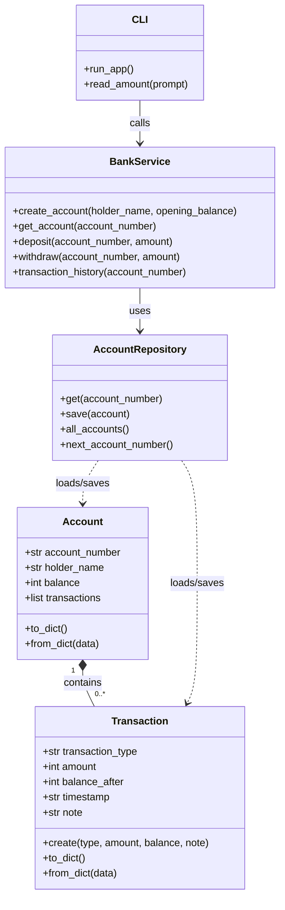

# Class Diagram

## Architecture

- **Models (`models.py`)**: Defines account and transaction data.
- **Repository (`repository.py`)**: Reads and writes JSON data.
- **Service (`service.py`)**: Contains validation and banking business rules.
- **CLI (`cli.py`)**: Displays the menu and reads user input.
- **Entry point (`main.py`)**: Starts the application.
